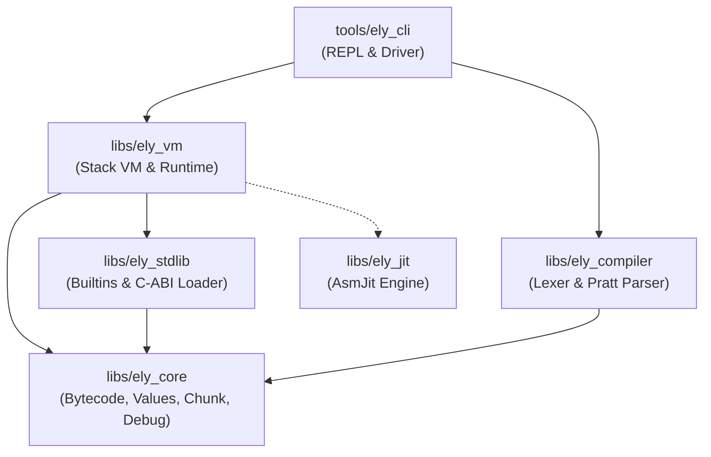
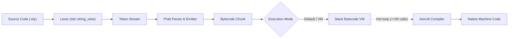

# Elysabettian Architecture & System Design (C++20)

This document details the end-to-end architecture of the **Elysabettian** language implementation in modern C++ (`elysabettian-cpp`), covering the compilation pipeline, virtual machine, and native JIT execution strategy.

---

## 1. High-Level Modular Architecture

The implementation is structured as a modular CMake workspace, strictly separating syntax, bytecode IR, execution, and native code generation:

### Module Breakdown

1. **`libs/ely_core`**: The foundational layer (zero dependencies).
   - **`Value`**: 64-bit NaN-boxed dynamic value representation (`sizeof(Value) == 8`) holding Numbers, Booleans, Null, and 48-bit Heap Objects.
   - **`Opcode`**: 8-bit instruction set enumeration and metadata (`opcode_name`).
   - **`Chunk`**: Executable bytecode buffer holding instruction stream, constant pool, string literals table, function constants, and compact `LineInfo` table.
   - **`Debug`**: High-level disassembler (`disassemble_chunk`, `disassemble_instruction`).

2. **`libs/ely_compiler`**: Front-end compiler.
   - **`Scanner` / `Lexer`**: Zero-allocation token stream generator based on `std::string_view` with line and column tracking.
   - **`Pratt Parser`**: Single-pass precedence-based parser emitting optimized bytecode instructions directly into `Chunk`. Handles expressions, statements, control structures (`if`, `while`, `for`), functions, classes, and `import`.

3. **`libs/ely_stdlib`**: Standard library and dynamic foreign function interface (FFI).
   - **Built-in Modules**: Core `math` (trigonometry, logarithms, powers, roots) and `io` (`clock`, `read`, `sleep`, `flush`).
   - **C-ABI Foreign Module Loader**: Dynamic plugin loader for external `.so` / `.dll` shared libraries via native dynamic loading (`dlopen` / `LoadLibrary`).

4. **`libs/ely_vm`**: Stack-based bytecode interpreter and managed heap.
   - **Stack & CallFrames**: Fixed-size value evaluation stack with call frames tracking return addresses, base stack slots, and function pointers.
   - **Managed Heap**: Memory manager for strings, arrays, functions, closures, classes, and instances.
   - **Invocation Profiler**: Detects hot loops and function calls triggering JIT compilation.

5. **`libs/ely_jit`**: Native Just-In-Time compiler powered by [AsmJit](https://asmjit.com/).
   - Generates native x86_64 / AArch64 machine instructions with near-zero latency, eliminating runtime Cranelift SSA translation overhead.

6. **`tools/ely_cli`**: Command-line interface and interactive environment.
   - Interactive REPL, script runner, and inspection flags (`--dump-bytecode`).

---

## 2. Compilation Pipeline

1. **Lexical Analysis**: Source code is scanned character-by-character using non-owning `std::string_view` without allocating intermediate token strings.
2. **Pratt Parsing**: Precedence-based parsing parses binary expressions, unary operators, grouping, and literals with minimal recursion overhead.
3. **Bytecode Emission**: Syntax constructs emit compact bytecode chunks. Local variables are resolved to stack frame slots at compile time.
4. **Execution**:
   - In **VM Mode**, the bytecode chunk is interpreted on the stack-based VM.
   - In **JIT Tier-up**, hot bytecode functions are lowered to native machine instructions via AsmJit.

---

## 3. Structural Comparison: Rust vs Modern C++

| Concept | Rust Implementation (`elysabettian-rs`) | C++20 Implementation (`elysabettian-cpp`) |
| :--- | :--- | :--- |
| **Slices and Substrings** | `&str`, `&[T]` | `std::string_view`, `std::span<const T>` |
| **Memory Allocation** | `Box<Chunk>` | `std::unique_ptr<Chunk>` with move semantics |
| **Type Conversions** | `f64::to_bits` / `f64::from_bits` | `std::bit_cast<uint64_t>` / `std::bit_cast<double>` |
| **Line Search** | `binary_search_by` | `std::ranges::lower_bound` with `&LineInfo::offset` projection |
| **String Formatting** | `format!` macro | `std::format` (compile-time checked format strings) |
| **JIT Code Generation** | Cranelift (heavy SSA IR compilation) | **AsmJit** (native, lightweight C++ assembler) |
