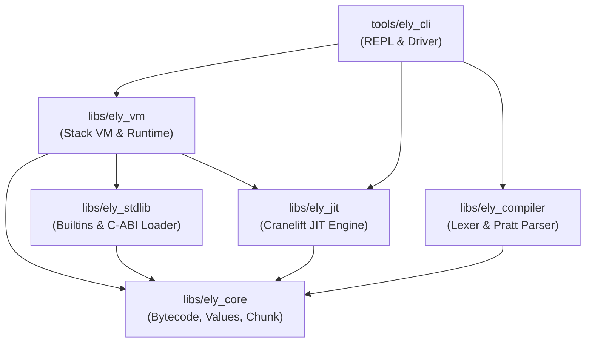
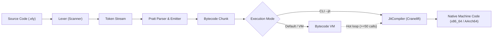

# Elysabettian Architecture & System Design

This document details the end-to-end architecture of the **Elysabettian** language implementation in Rust (`elysabettian-rs`), covering the compilation pipeline, virtual machine, Cranelift JIT engine, and multi-tier execution strategy.

---

## 1. High-Level Workspace Architecture

The implementation is structured as a modular Cargo workspace, strictly separating syntax, bytecode IR, execution, and native code generation:



### Crate Breakdown

1. **`libs/ely_core`**: The foundational layer.
   - **`Value`**: 64-bit NaN-boxed dynamic value representation (Numbers, Booleans, Null, and Heap Objects).
   - **`Opcode`**: Bytecode instruction set enumeration and metadata.
   - **`Chunk`**: Executable bytecode buffer holding bytecode stream, constant pool (numbers, booleans, string descriptors), string constants table, and line debug info.

2. **`libs/ely_compiler`**: Front-end compiler.
   - **`Lexer` / `Scanner`**: Zero-allocation token stream generator with source line tracking. Supports both single and double quotes.
   - **`Parser`**: Single-pass Pratt parser emitting optimized bytecode instructions directly into `Chunk`. Handles expressions, statement blocks, variable bindings, control structures (`if`, `while`, `for`), functions, classes, and `import` declarations.

3. **`libs/ely_stdlib`**: Standard library and dynamic foreign function interface (FFI).
   - **Built-in Modules**: Core `math` (trigonometry, logarithms, powers, roots, constants) and `io` (`clock`, `read`, `sleep`, `flush`).
   - **C-ABI Foreign Module Loader**: Dynamic plugin loader for external `.so` / `.dylib` shared libraries via `ElyApi`.

4. **`libs/ely_vm`**: Stack-based bytecode interpreter and managed heap.
   - **Stack & CallFrames**: Fixed-size value evaluation stack with call frames tracking return addresses, base stack slots, and function pointers.
   - **Heap**: Managed pool of strings, arrays, functions, closures, classes, and instances.
   - **Hot-Path Detection**: Transparent invocation profiling triggering dynamic JIT compilation.

5. **`libs/ely_jit`**: Just-In-Time compiler powered by [Cranelift](https://cranelift.dev/).
   - **`JitEngine`**: Configures ISA builder, target machine specifications, registers C-ABI runtime symbols, and manages executable memory.
   - **`JitCompiler`**: Lowers Elysabettian bytecode instructions into Cranelift SSA Intermediate Representation (IR), constructs Control Flow Graphs (CFG), and compiles them to native machine code.

6. **`tools/ely_cli`**: Command-line interface and interactive environment.
   - **Script Execution**: Runs source files using VM or pure JIT native mode.
   - **REPL**: Interactive shell powered by `rustyline` with history and multi-line support.
   - **Inspection Flags**: `--dump-ir` for Cranelift SSA IR and `--dump-asm` for native VCode disassembly.

---

## 2. Compilation Pipeline

The journey from source code to execution follows a streamlined pipeline:



1. **Lexical Analysis**: Source code is scanned character-by-character without allocating intermediate strings for tokens.
2. **Pratt Parsing**: Precedence-based parsing parses binary expressions, unary operators, grouping, and literals with minimal recursion overhead.
3. **Bytecode Emission**: Syntax constructs emit compact bytecode chunks. Local variables are resolved to stack frame slots at compile time.
4. **Code Generation**:
   - In **VM Mode**, the bytecode chunk is interpreted on the stack-based VM.
   - In **JIT Mode**, the bytecode chunk is directly lowered into Cranelift IR basic blocks and compiled to machine instructions.

---

## 3. Dual-Tier Execution Engine & Hot-Path Tier-Up

Elysabettian employs a hybrid execution strategy combining low startup overhead with native execution performance.

### Tier 1: Bytecode Virtual Machine (`ely_vm`)
The virtual machine interprets bytecode chunks through a tight dispatch loop. It manages the runtime heap, object allocations, garbage collection roots, and dynamic dispatch.

### Tier 2: Cranelift JIT Compilation (`ely_jit`)
Functions identified as performance-critical are lowered into Cranelift SSA blocks. Local variables are mapped to Cranelift variables (SSA registers), arithmetic operations become native hardware instructions (e.g. `vaddsd`, `vmulsd`, `vucomisd`), and control flow branches become native jumps.

### Dynamic Hot-Path Tier-Up
Every function object (`ObjFunction`) maintains an `invocation_count` and an optional native entry pointer (`jit_entry`):

```text
Function Invocation
       │
       ▼
[invocation_count++]
       │
       ├─► Has JIT entry? ───► YES ───► Execute Native Function Pointer
       │
       └─► invocation_count >= 50?
                 │
                 ├──► YES ───► Compile Function with JitCompiler
                 │             Store entry point in ObjFunction.jit_entry
                 │             Execute Native Function Pointer
                 │
                 └──► NO ────► Interpret via Bytecode VM CallFrame
```

When native code finishes execution, it returns the result value directly to the caller frame's stack, maintaining full compatibility with non-JIT frames.

---

## 4. Runtime ABI & Trampolines

Native JIT code interacts with language runtime features through standardized C-ABI helper trampolines registered on `JITBuilder`:

* `ely_jit_set_global(name_idx: u32, value_bits: u64)`: Stores a global variable value.
* `ely_jit_get_global(name_idx: u32) -> u64`: Retrieves a global variable value.
* `ely_jit_print_value(value_bits: u64)`: Formats and prints any dynamic value (resolving strings from the string pool).

---

## 5. Value Representation

Values are stored in a compact 64-bit NaN-boxed layout:
* Unboxed IEEE-754 double precision floats.
* Tagged constants for `null`, `true`, and `false`.
* Heap references stored in the 48-bit payload with the sign bit and Quiet NaN bits set.

For the exhaustive specification, see [NaN-Boxing Value Specification](nan_boxing_specification.md).

---

## 6. Standard Library & Dynamic C-ABI Module Loader

Elysabettian provides a modular standard library and foreign function interface (FFI) managed by [`ModuleRegistry`](../libs/ely_stdlib/src/lib.rs):

### 6.1 Two-Tier Module Loading
When an `import("<module>");` statement is executed:
1. **Tier 1 (Built-in Modules)**: The registry looks up static built-in modules compiled into the binary:
   - `math`: Square roots (`sqrt`), powers (`pow`), absolute values (`abs`), rounding (`floor`, `ceil`, `round`, `trunc`), trigonometry (`sin`, `cos`, `tan`, `asin`, `acos`, `atan`, `atan2`), exponential and logarithms (`exp`, `log`, `log10`, `log2`), `hypot`, `min`, `max`, and mathematical constants (`PI`, `TAU`, `E`, `INFINITY`).
   - `io` / `stdio`: High-resolution timing (`clock`, `time`), console input (`read`), thread execution throttling (`sleep`), and output flushing (`flush`).
2. **Tier 2 (Foreign Shared Objects)**: If not found among built-ins, the loader searches for `lib<module>.so` or `<module>.so` across designated search directories (`./modules`, `./`, `/usr/local/lib/ely`) and loads them dynamically using `libloading`.

### 6.2 C-ABI Plugin Specification
Foreign modules authored in C, C++, or Rust export a single initialization function:
```c
int ely_init_module(ElyApi* api);
```
where `ElyApi` exposes C-compatible function pointers to dynamically register functions and numeric constants into the VM without requiring engine recompilation.
