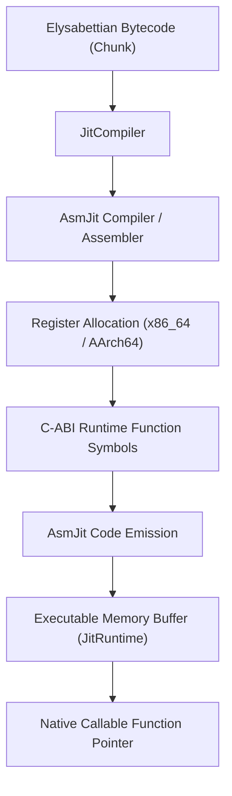
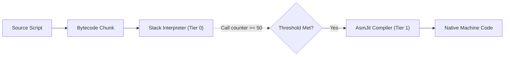

# AsmJit Native JIT Compiler Architecture & Specification

The **`ely_jit`** library provides native machine code compilation for Elysabettian using [AsmJit](https://asmjit.com/), a lightweight, zero-dependency C++ Just-In-Time code generation library.

---

## 1. JIT Architecture Overview



The JIT pipeline consists of:
1. **Target Architecture Detection**: Configured via AsmJit's architecture support targeting host x86_64 (AVX/SSE2) or AArch64 (NEON).
2. **Bytecode to Machine Lowering**: Iterates over bytecode instructions and emits direct machine instructions into an `asmjit::x86::Compiler` (or Assembler) stream.
3. **Control Flow Graph (CFG) Construction**: Resolves forward jumps, conditional jumps (`Opcode::JumpZero`), and loops (`Opcode::Loop`) directly to AsmJit `Label` instances.
4. **Runtime ABI Trampolines**: Directly interfaces with C++ runtime functions without intermediary FFI overhead.
5. **Memory Management**: Uses `asmjit::JitRuntime` to allocate executable pages with appropriate OS permissions (`mprotect` / `VirtualProtect`).

---

## 2. Bytecode to Machine Instruction Mapping

Unlike Cranelift's heavy SSA compilation pipeline, AsmJit generates machine instructions directly with near-zero latency, making it ideal for dynamic language JIT compilation.

### Local Variables and Hardware Registers
* Call frame local variables are mapped to hardware registers using AsmJit's virtual registers (`x86::Gp` / `x86::Xmm`).
* Floating point arithmetic leverages hardware SIMD registers directly.
* Hot numeric paths eliminate NaN-boxing overhead during loop execution, re-boxing values only when exiting back to the VM.

### Instruction Mapping Table (x86_64)

| Elysabettian Bytecode | AsmJit High-Level Operation | Native Instruction (x86_64) |
| :--- | :--- | :--- |
| `Opcode::Constant(idx)` | Load float / double immediate | `movsd %xmmN, [const_pool + disp]` |
| `Opcode::Add` | Floating point addition | `addsd %xmmA, %xmmB` |
| `Opcode::Subtract` | Floating point subtraction | `subsd %xmmA, %xmmB` |
| `Opcode::Multiply` | Floating point multiplication | `mulsd %xmmA, %xmmB` |
| `Opcode::Divide` | Floating point division | `divsd %xmmA, %xmmB` |
| `Opcode::Negate` | Float sign flip | `xorpd %xmmA, [sign_mask]` |
| `Opcode::Equal` | Float comparison | `ucomisd` + `sete` |
| `Opcode::Greater` | Float comparison | `ucomisd` + `seta` |
| `Opcode::Less` | Float comparison | `ucomisd` + `setb` |
| `Opcode::Not` | Check falsy (null / false) | Bitwise check against `NULL_VAL` & `FALSE_VAL` |

---

## 3. Control Flow & Loops

Control flow structures (`if`, `while`, `for`) are mapped onto AsmJit labels:

### Conditional Branches (`Opcode::JumpZero`)
1. Evaluates truthiness of the condition.
2. Emits conditional jump to an AsmJit label:
   ```cpp
   cc.test(cond_reg, cond_reg);
   cc.jz(else_label);
   ```

### Loops (`Opcode::Loop`)
1. Loop headers bind an `asmjit::Label loop_start = cc.newLabel();`.
2. Body executes natively without bytecode interpreter dispatch loop overhead.
3. The loop tail emits an unconditional branch:
   ```cpp
   cc.jmp(loop_start);
   ```

---

## 4. Multi-Tier Execution Strategy



1. **Tier 0 (Interpreter)**: Quick start-up execution via stack VM. Each function call tracks an invocation counter.
2. **Tier 1 (AsmJit JIT)**: When invocation threshold (e.g. 50 calls) is reached, `ely_jit` compiles the target `Chunk` into executable memory and hot-swaps the function pointer in the VM.
