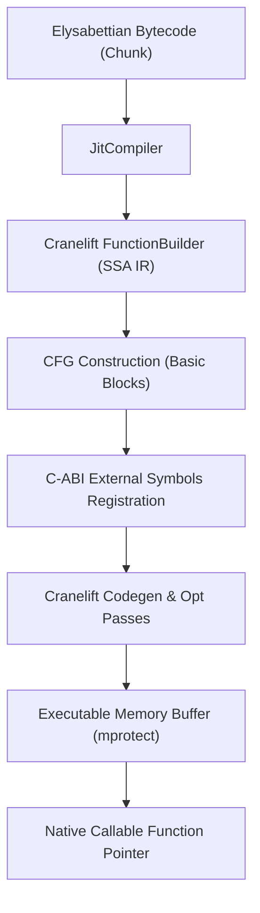

# Cranelift JIT Compiler Architecture & Specification

The **`ely_jit`** crate provides high-performance native machine code compilation for Elysabettian using [Cranelift](https://cranelift.dev/), the code generator behind WebAssembly runtimes like Wasmtime.

---

## 1. JIT Architecture Overview



The JIT pipeline consists of:
1. **Target Machine Configuration**: Detects host architecture (e.g. x86_64, AArch64) using `target_lexicon` and configures Cranelift compilation flags (`opt_level = speed`).
2. **Intermediate Representation (IR) Translation**: Maps Elysabettian stack bytecode to Cranelift Static Single Assignment (SSA) values and basic blocks.
3. **Control Flow Graph (CFG) Construction**: Resolves forward jumps, conditional branches, and backward loops to Cranelift blocks and block arguments.
4. **Runtime ABI Trampolines**: Provides C-compatible symbol trampolines to interact with dynamic global variables and string formatting.
5. **Machine Code Emission**: Emits binary machine instructions into executable memory pages and produces callable function pointers (`extern "C" fn() -> f64`).

---

## 2. Bytecode to Cranelift SSA Lowering

Unlike the stack-based virtual machine, Cranelift uses a pure register-based SSA representation.

### Local Variables and SSA Form
* Local variable slots are mapped directly to Cranelift `Variable` instances (`builder.declare_var`).
* Reading a local (`Opcode::GetLocal`) executes `builder.use_var`.
* Writing to a local (`Opcode::SetLocal`) executes `builder.def_var`.
* Cranelift's register allocator automatically places these variables into hardware CPU registers (e.g., `%xmm0-%xmm15` on x86_64).

### Instruction Mapping Table

| Elysabettian Bytecode | Cranelift SSA Instruction | Machine Equivalent (x86_64) |
| :--- | :--- | :--- |
| `Opcode::Constant(idx)` | `builder.ins().f64const(n)` | `vmovq %rax, %xmmN` |
| `Opcode::Add` | `builder.ins().fadd(a, b)` | `vaddsd %xmmB, %xmmA, %xmmDst` |
| `Opcode::Subtract` | `builder.ins().fsub(a, b)` | `vsubsd %xmmB, %xmmA, %xmmDst` |
| `Opcode::Multiply` | `builder.ins().fmul(a, b)` | `vmulsd %xmmB, %xmmA, %xmmDst` |
| `Opcode::Divide` | `builder.ins().fdiv(a, b)` | `vdivsd %xmmB, %xmmA, %xmmDst` |
| `Opcode::Negate` | `builder.ins().fneg(a)` | `vxorpd %xmmMask, %xmmA, %xmmDst` |
| `Opcode::Equal` | `fcmp eq` + `select` (1.0 / 0.0) | `vucomisd` + conditional set |
| `Opcode::Greater` | `fcmp gt` + `select` (1.0 / 0.0) | `vucomisd` + conditional set |
| `Opcode::Less` | `fcmp lt` + `select` (1.0 / 0.0) | `vucomisd` + conditional set |
| `Opcode::Not` | `fcmp eq 0.0` + `select` (1.0 / 0.0) | `vucomisd` + conditional set |

---

## 3. Control Flow & Loops

Control flow structures (`if`, `while`, `for`) are mapped onto Cranelift basic blocks:

### Conditional Branches (`JumpIfFalse`)
1. The condition value is popped and compared with `0.0` (`false`/`nil` representation).
2. The compiler emits `builder.ins().brif(cond, then_block, else_block)`.
3. If the current basic block already ended with a terminator (`jump`, `brif`, or `return_`), subsequent instructions start cleanly in the destination block.

### Loops (`Opcode::Loop`)
1. Loops generate a backward jump target block `header_block`.
2. Variables modified across loop iterations are carried as Cranelift block arguments or SSA variables.
3. The end of the loop emits an unconditional `builder.ins().jump(header_block, &[])`.

---

## 4. Runtime Trampolines & External Symbols

Because Elysabettian features dynamic global variables and string pools, the JIT engine provides C-ABI external symbols registered on Cranelift's `JITBuilder`:

```rust
pub extern "C" fn ely_jit_set_global(name_idx: u32, value_bits: u64) { ... }
pub extern "C" fn ely_jit_get_global(name_idx: u32) -> u64 { ... }
pub extern "C" fn ely_jit_print_value(value_bits: u64) { ... }
```

When JIT encounters `Opcode::DefineGlobal`, `Opcode::SetGlobal`, `Opcode::GetGlobal`, or `Opcode::Print`, it emits a direct function call (`builder.ins().call(fn_ref, &[...])`) linking into these thread-safe trampolines.

---

## 5. Inspecting IR and Machine Code

The CLI provides built-in inspection flags to observe the compilation pipeline:

### Cranelift SSA IR (`--dump-ir`)
Prints the textual SSA intermediate representation generated by the compiler before native lowering:

```shell
cargo run -p ely_cli -- --jit --dump-ir examples/bench_loop.ely
```

```text
=== Cranelift IR [main_jit] ===
function u0:0() -> f64 system_v {
block0:
    v0 = f64const 0.0
    ...
block1(v7: f64):
    ...
    brif v21, block5, block2
}
```

### Native Disassembly (`--dump-asm`)
Prints the generated native assembly (Cranelift VCode disassembly) for the host architecture:

```shell
cargo run -p ely_cli -- --jit --dump-asm examples/bench_loop.ely
```

```text
=== Machine Code Disassembly [main_jit] ===
  pushq   %rbp
  movq    %rsp, %rbp
  subq    %rsp, $32, %rsp
block0:
  vxorpd  %xmm3, %xmm3, %xmm1
  ...
  vaddsd  %xmm5, %xmm1, %xmm5
  ret
```
