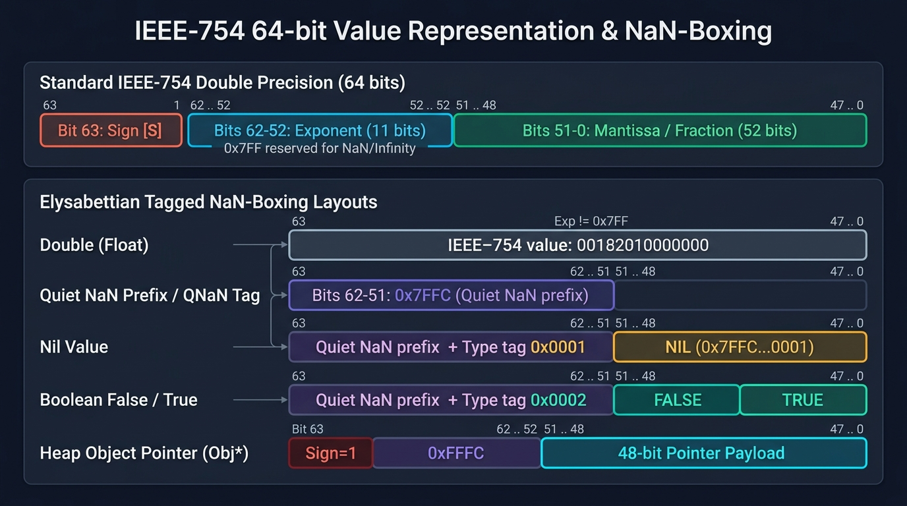

# Value Representation: NaN-Boxing Specification

This document defines the 64-bit IEEE-754 NaN-boxed value representation used across the Elysabettian runtime and Cranelift JIT compiler.

---

## Architecture Diagram



---

## 1. IEEE-754 Double Precision Architecture

A standard 64-bit floating point number is structured as follows:

```text
 1 bit         11 bit                               52 bit
[Sign] [      Exponent     ] [                     Mantissa                     ]
  63    62                52   51                                              0
```

* **Standard Doubles:** Exponent is not all 1s (`exponent != 0x7FF`).
* **Quiet NaN (qNaN):** All 11 exponent bits are 1, and bit 51 is 1 (`0x7FF8_0000_0000_0000`).
* **Payload:** The lower 51 bits of a Quiet NaN are ignored by floating-point hardware units (FPU).

---

## 2. Elysabettian NaN-Boxing Memory Layout

By claiming Quiet NaN representations, we pack all dynamic language types (`Nil`, `Bool`, numbers, and heap pointers/handles) into **exactly 8 bytes** (`sizeof(Value) == 8`).

```text
Double:
[s] [     exp != 0x7FF     ] [               52-bit mantissa                    ]

Nil:
[0] [ 11111111111 (0x7FF)  ] [1] [000 ... 000] [0001]

False:
[0] [ 11111111111 (0x7FF)  ] [1] [000 ... 000] [0010]

True:
[0] [ 11111111111 (0x7FF)  ] [1] [000 ... 000] [0011]

Heap Object (Pointer / Handle):
[1] [ 11111111111 (0x7FF)  ] [1] [         48-bit pointer / handle payload      ]
 ^
 Sign bit set identifies heap objects
```

---

## 3. Bitmasks and Constants

| Identifier | Hexadecimal Value | Binary / Semantic Meaning |
| :--- | :--- | :--- |
| `SIGN_BIT` | `0x8000_0000_0000_0000` | Sign bit (bit 63). |
| `QNAN` | `0x7FFC_0000_0000_0000` | Exponent (11 bits) + Quiet NaN bit (bit 51) set. |
| `TAG_NIL` | `0x0001` | Payload tag for `nil`. |
| `TAG_FALSE` | `0x0002` | Payload tag for `false`. |
| `TAG_TRUE` | `0x0003` | Payload tag for `true`. |
| `PAYLOAD_MASK`| `0x0000_FFFF_FFFF_FFFF` | Lower 48 bits (standard 48-bit virtual address space). |

### Full Concrete Values:
* **`NIL_VAL`** = `QNAN | TAG_NIL` (`0x7FFC_0000_0000_0001`)
* **`FALSE_VAL`** = `QNAN | TAG_FALSE` (`0x7FFC_0000_0000_0002`)
* **`TRUE_VAL`** = `QNAN | TAG_TRUE` (`0x7FFC_0000_0000_0003`)
* **`OBJ_TAG`** = `SIGN_BIT | QNAN` (`0xFFFC_0000_0000_0000`)

---

## 4. Arithmetic and Type Guards

### 4.1 Type Predicates
1. **`is_number(v)`**: `(v.bits & QNAN) != QNAN` (True for all valid numbers and canonical NaN).
2. **`is_nil(v)`**: `v.bits == NIL_VAL`.
3. **`is_bool(v)`**: `v.bits == TRUE_VAL || v.bits == FALSE_VAL` (or `(v.bits | 1) == TRUE_VAL`).
4. **`is_obj(v)`**: `(v.bits & (SIGN_BIT | QNAN)) == OBJ_TAG`.

### 4.2 NaN Canonicalization
When user code produces an arithmetic NaN (e.g. `0.0 / 0.0`), it must be canonicalized to avoid colliding with language tags:
```rust
if n.is_nan() {
    // Standard Quiet NaN with zero payload
    0x7FF8_0000_0000_0000
} else {
    n.to_bits()
}
```

### 4.3 Truthiness Rules
In Elysabettian:
* Only `nil` and `false` are **falsy**.
* `0.0`, `""`, and all objects/numbers are **truthy**.
```rust
is_truthy(v) = !(v.is_nil() || (v.is_bool() && !v.as_bool()))
```
