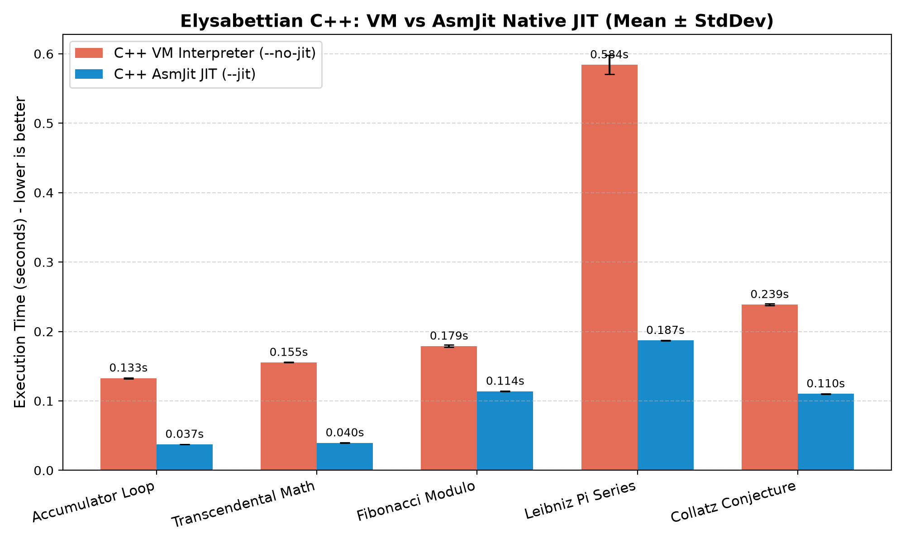
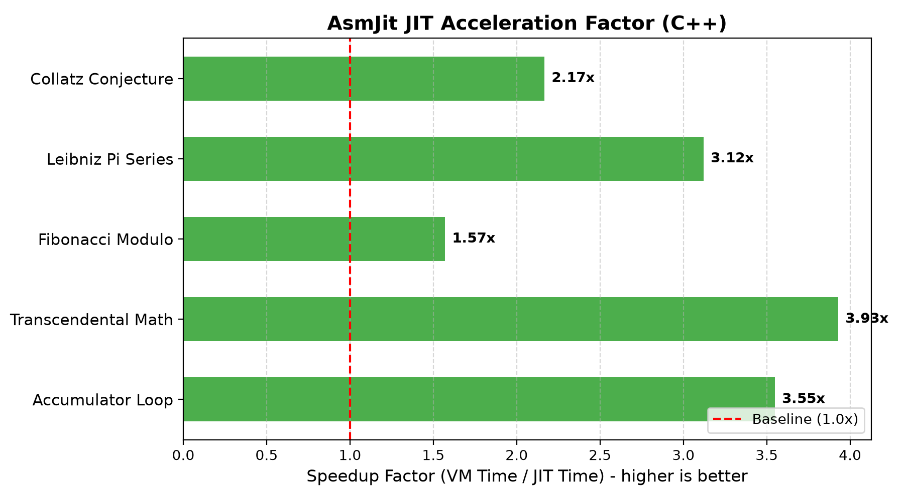
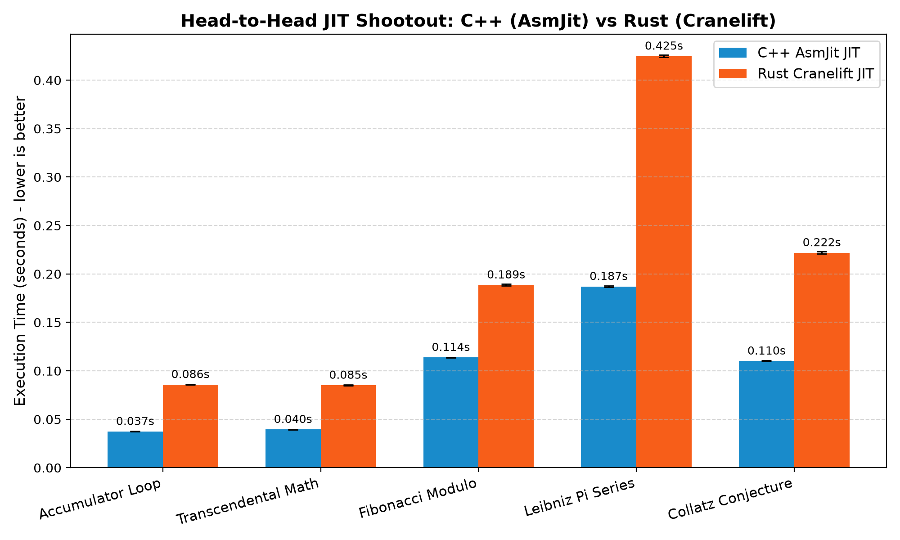

# Elysabettian Scientific Benchmark Report

Evaluation of runtime performance comparing C++ (AsmJit JIT) with Bytecode VM and Rust (Cranelift JIT).

### Methodology
- **Hardware Platform:** Host CPU native instruction execution.
- **Execution Rounds:** 2 warmup iterations followed by 5 timed evaluation runs per workload.
- **Statistical Metrics:** Sample Mean ($\mu$), Sample Standard Deviation ($\sigma$), and Speedup Factor ($\mu_{VM} / \mu_{JIT}$).
- **Parity Verification:** Numerical floating-point equivalence across runtimes.

### C++ Benchmark Results (VM vs AsmJit JIT)

| Workload | Description | C++ VM Mean (s) | C++ JIT Mean (s) | Speedup | Parity |
| :--- | :--- | :---: | :---: | :---: | :---: |
| **Accumulator Loop** | Numeric accumulator loop (2,000,000 iters) | 0.1329s ± 0.0006 | 0.0374s ± 0.0002 | **3.55x** | Verified |
| **Transcendental Math** | Floating-point multiply/divide with Pi & e (2,000,000 iters) | 0.1554s ± 0.0003 | 0.0396s ± 0.0003 | **3.93x** | Verified |
| **Fibonacci Modulo** | Iterative Fibonacci sequence (1,000,000 iters) | 0.1789s ± 0.0017 | 0.1139s ± 0.0003 | **1.57x** | Verified |
| **Leibniz Pi Series** | Alternating infinite series Pi approximation (5,000,000 iters) | 0.5841s ± 0.0138 | 0.1871s ± 0.0005 | **3.12x** | Verified |
| **Collatz Conjecture** | 3n + 1 trajectory steps using bitwise shifts (25,000 ranges) | 0.2388s ± 0.0011 | 0.1102s ± 0.0003 | **2.17x** | Verified |

### Head-to-Head Comparison: C++ (AsmJit) vs Rust (Cranelift)

| Workload | C++ JIT (AsmJit) | Rust JIT (Cranelift) | Relative Advantage | Parity |
| :--- | :---: | :---: | :---: | :---: |
| **Accumulator Loop** | 0.0374s | 0.0859s | C++ is **2.29x faster** | Verified |
| **Transcendental Math** | 0.0396s | 0.0852s | C++ is **2.15x faster** | Verified |
| **Fibonacci Modulo** | 0.1139s | 0.1887s | C++ is **1.66x faster** | Verified |
| **Leibniz Pi Series** | 0.1871s | 0.4248s | C++ is **2.27x faster** | Verified |
| **Collatz Conjecture** | 0.1102s | 0.2219s | C++ is **2.01x faster** | Verified |

### Visual Performance Charts

